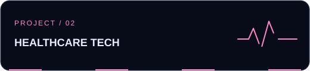
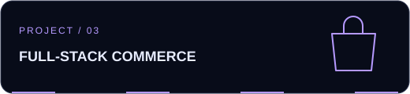
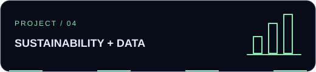
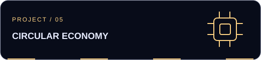
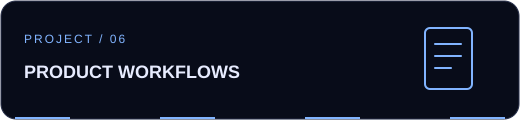

  <picture>
    <source media="(prefers-color-scheme: light)" srcset="assets/header-light.svg">
    
  </picture>

  <a href="#selected-projects">Selected projects</a> &nbsp; / &nbsp;
  <a href="#my-toolkit">My toolkit</a> &nbsp; / &nbsp;
  <a href="mailto:janidukalhara99@gmail.com">Email me</a> &nbsp; / &nbsp;
  <a href="https://www.linkedin.com/in/janidu-perera/">LinkedIn</a>

## Hi, I'm Janidu.

I'm a software engineering graduate based in **Sri Lanka**, building web applications that connect thoughtful interfaces, practical backend systems, and AI.

**BSc (Hons) Computer Science (Software Engineering) — First Class**  
Kingston University, UK · via ESOFT, Sri Lanka

My projects span computer vision, prescription workflows, e-commerce, and sustainability. I enjoy taking an idea through the whole stack: **interface → API → data → useful results**.

**Open to software engineering internships, junior developer roles, and collaborations.**

 

## Selected projects

Explore the code, the problem, and the implementation.

<table>
<tr>
<td width="50%" valign="top">

<h3><a href="https://github.com/janidukalhara/Culinary-Assistant">Culinary Assistant</a></h3>

Turn a fridge photo into detected ingredients and recipe ideas. YOLO inference returns bounding boxes and confidence scores through a FastAPI service.

<b>React · TypeScript · Python · FastAPI · YOLO · OpenCV</b>

<a href="https://github.com/janidukalhara/Culinary-Assistant">Explore repository ↗</a>

</td>
<td width="50%" valign="top">

<h3><a href="https://github.com/janidukalhara/medilink">MediLink</a></h3>

A prescription management project connecting patients and pharmacies, with OCR/NLP processing, quotation comparison, and role-based dashboards.

<b>React · TypeScript · Express · MongoDB · FastAPI</b>

<a href="https://github.com/janidukalhara/medilink">Explore repository ↗</a>

</td>
</tr>
<tr>
<td width="50%" valign="top">

<h3><a href="https://github.com/janidukalhara/Nexus-J-Commerce">Nexus J Commerce</a></h3>

A fashion storefront with product filtering, variants, carts, wishlists, reviews, and order workflows, backed by a typed API and relational data.

<b>React · TypeScript · Express · PostgreSQL · Drizzle</b>

<a href="https://github.com/janidukalhara/Nexus-J-Commerce">Explore repository ↗</a>

</td>
<td width="50%" valign="top">

<h3><a href="https://github.com/janidukalhara/TerraMind-Analytics">TerraMind Analytics</a></h3>

A municipal waste analytics prototype for Sri Lanka, with zone-risk views, event analysis, and charts. Integrates Gemini with a simulated fallback.

<b>React · TypeScript · Express · PostgreSQL · Recharts</b>

<a href="https://github.com/janidukalhara/TerraMind-Analytics">Explore repository ↗</a>

</td>
</tr>
<tr>
<td width="50%" valign="top">

<h3><a href="https://github.com/janidukalhara/eScrap-Link">eScrap-Link</a></h3>

An electronic scrap marketplace with image-based device analysis, suggested salvageable components, listings, and component bounties.

<b>React · TypeScript · Express · PostgreSQL · Gemini</b>

<a href="https://github.com/janidukalhara/eScrap-Link">Explore repository ↗</a>

</td>
<td width="50%" valign="top">

<h3><a href="https://github.com/janidukalhara/OEH-TRADERS">OEH Traders</a></h3>

A product catalogue and quotation application with customer and dealer accounts, shopping carts, and administrative workflows.

<b>React · JavaScript · Python · FastAPI · MongoDB</b>

<a href="https://github.com/janidukalhara/OEH-TRADERS">Explore repository ↗</a>

</td>
</tr>
</table>

**Creative highlight — [Digital Vesak](https://digital-vesak.vercel.app/)**  
My digital Vesak experience · **1st place, ESU Digital Vesak Lantern Competition**.

<b>Inside the engineering</b> — a closer look at three projects

- **Culinary Assistant:** image upload → YOLO detection → annotated results → ingredient extraction → Gemini recipe suggestions. Supports pretrained detection modes and a custom-training pipeline.
- **MediLink:** a React frontend, Express application API, and separate Python AI service keep the interface, business workflows, and document processing distinct.
- **Nexus J Commerce:** a TypeScript workspace with PostgreSQL/Drizzle, Zod validation, and an OpenAPI-generated React API client.

## My toolkit

| Area | Technologies I use |
| :--- | :--- |
| **Interfaces** | React, Next.js, TypeScript, JavaScript, Tailwind CSS |
| **APIs & applications** | Node.js, Express, Python, FastAPI, PHP, Laravel, C# / .NET |
| **Data** | PostgreSQL, MySQL, MongoDB, SQL Server, Drizzle ORM |
| **AI integration** | YOLO, OpenCV, OCR/NLP workflows, Gemini API |
| **Development & design** | Git, GitHub, Postman, Figma, Vite |

## What I'm focused on

- Connecting computer vision and AI services to useful, understandable interfaces.
- Improving API design, validation, testing, and application reliability.
- Building full-stack projects that solve practical problems in Sri Lanka.

---

### Let's build something useful.

Have a role, project, or idea that fits my work? I'd love to hear about it.

**[janidukalhara99@gmail.com](mailto:janidukalhara99@gmail.com)** · **[LinkedIn](https://www.linkedin.com/in/janidu-perera/)** · **[All repositories](https://github.com/janidukalhara?tab=repositories)**

Based in Sri Lanka · Curious about the whole stack.

